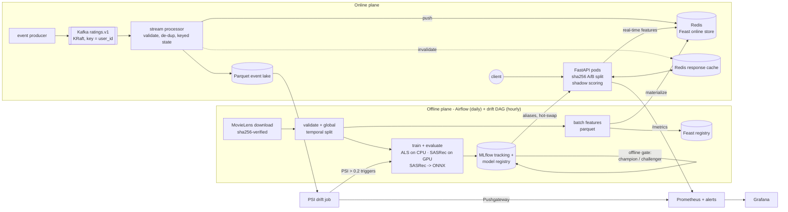

# MLOps Recommendation Pipeline

**A movie recommender run like a production system (streaming events, feature store, model
registry with a release gate, A/B and shadow traffic, monitoring, drift-triggered retraining),
plus one research question: does a transformer beat matrix factorisation?**

[](https://github.com/Hardik1608/mlops-recommendation-pipeline/actions)
[](https://www.python.org/)
[](LICENSE)

- **+16% NDCG@10** for the served hybrid ALS over a tuned popularity baseline (MovieLens 1M;
  +13% on 25M ratings; paired bootstrap, p < 0.001).
- **3.8 ms P95** at 327 req/s on one API worker, 0 errors; the 100 ms SLO holds up to 80% load.
- **The transformer (SASRec) wins 1.6–4.9× under the protocol most papers use, and loses
  28–49% on held-out future data.** It failed the release gate, so it runs in **shadow mode**:
  scored on live traffic, never shown to users.
- **End to end:** Kafka → Feast → MLflow champion/challenger → FastAPI → Prometheus/Grafana;
  PSI drift triggers Airflow retraining; Docker Compose and Helm.


**Stack:** PyTorch · ONNX Runtime · Kafka · Feast · MLflow · Airflow · FastAPI · Redis ·
Prometheus/Grafana · Docker Compose · Helm · GitHub Actions

Write-up with interactive demo: **[hardik1608.github.io/projects/recommender.html](https://hardik1608.github.io/projects/recommender.html)**

## Documentation

| | |
|---|---|
| [Design document](docs/DESIGN.md) | Requirements, data flow, failure modes, capacity estimate, what changes at 10× traffic |
| [Reports](reports/) | Every number below: benchmarks, tuning grids, drift, load tests (JSON + Markdown) |
| [Configs](configs/) | Per-dataset training configs, each value traceable to a tuning report; [tuning plans](configs/tuning/) |
| [Scripts](scripts/) | GPU stages (`gpu.sh`), shadow-deployment demo (`shadow_demo.sh`), site data (`site_data.py`) |

---

## The question, and the answer

All models share the same temporal split, cold-start fallback and evaluation code, and each was
tuned on the validation window only, with comparable budgets ([tuning plans](configs/tuning/)).
The comparison was then repeated under leave-one-out, the protocol most sequential-recommendation
papers report, and with SASRec trained on **shuffled** histories as a control. Temporal-split
numbers are over **returning** test users: every model gives new users the same popularity
fallback (65% of ml-25m test users are new), so including them only dilutes the differences.

**NDCG@10:**

| Model | ml-1m, temporal | ml-1m, leave-one-out | ml-25m, temporal | ml-25m, leave-one-out |
|---|---|---|---|---|
| Popularity (tuned) | 0.201 | 0.019 | 0.118 | 0.016 |
| Implicit ALS | 0.220 | 0.036 | 0.122 | 0.053 |
| **Hybrid ALS** (implicit ALS + trending prior, served) | **0.233** | 0.015 | **0.132** | 0.030 |
| SASRec (2-block causal transformer, GPU) | 0.119 | **0.176** | 0.095 | **0.083** |
| SASRec trained on shuffled histories | 0.146 | 0.035 | 0.100 | 0.037 |

- **Under leave-one-out, SASRec beats ALS** (4.9× on ml-1m, 1.6× on ml-25m), in line with the
  literature. Shuffle each user's history and that advantage is gone (−80%, −56%): it is learned
  *order*.
- **On the held-out future, SASRec loses to the served hybrid** (−49% on ml-1m, −28% on
  ml-25m), and the shuffled model beats the ordered one: the same order hurts.
- **Why:** MovieLens users rate movies from lists the site generated, mostly in one sign-up
  session, so rating order is partly an interface artefact. Leave-one-out asks for the next
  rating of that session; a temporal split asks for ratings made weeks or months later. Both
  effects are documented: [Ji et al., ACM TOIS 2023](https://arxiv.org/abs/2010.11060) (leakage
  in leave-one-out), [*Our Model Achieves Excellent Performance on MovieLens: What Does it
  Mean?*](https://arxiv.org/abs/2307.09985) (MovieLens order).
- **With fresh events, order becomes useful again.** Given each returning user's first five
  test-window ratings as real-time context, SASRec improves by **+64%** (ml-1m) and **+33%**
  (ml-25m), against +8% and +7% for the hybrid, and ordered SASRec then beats shuffled by about
  10%. A sequential model is only worth serving behind a real-time event pipeline.
- SASRec recommends far more of the catalogue (45% vs 4.7% of ml-1m in the top-10s): less
  popularity bias, a real product trade-off even where its accuracy is lower.

**Is it real?** Paired bootstrap over the same returning test users (2,000 resamples):

| Comparison (NDCG@10) | ml-1m (1,159 users) | ml-25m (6,330 users) |
|---|---|---|
| Hybrid ALS vs popularity | +16.0% [+12.3, +20.1] | +12.6% [+10.3, +15.1] |
| Hybrid vs implicit ALS (the trending prior) | +6.0% [+2.8, +9.5] | +8.3% [+5.0, +11.6] |
| SASRec vs hybrid ALS | −49.0% [−53.3, −44.9] | −28.3% [−31.1, −25.4] |
| Shuffled vs ordered SASRec | +23.1% [+12.6, +35.4] | +5.1% [+0.5, +9.9] |

95% intervals; p < 0.001 everywhere except shuffled vs ordered on ml-25m (p = 0.034).

Because SASRec lost the offline gate, it runs in **shadow mode** in the API: scored on 20% of
live requests in the background, measured in Grafana, never shown to a user.

Reports: [`benchmark_ml-1m.md`](reports/benchmark_ml-1m.md),
[`benchmark_ml-25m.md`](reports/benchmark_ml-25m.md); tuning:
[`reports/tuning/`](reports/tuning/).

---

## Architecture



Request path: **A/B bucket** → **Redis cache** (key includes the model version) → **Feast
real-time features** (events newer than the model's training cutoff) → **in-process scoring**
(ALS embedding or fold-in of fresh events; SASRec through ONNX Runtime; popularity for unknown
users) → response + cache fill → optional **shadow scoring** in a background thread. Details,
failure modes and capacity: [`docs/DESIGN.md`](docs/DESIGN.md).

---

## Results

Protocol for everything below: global temporal split 80/10/10 by timestamp (every training
event precedes every test event); hyper-parameters selected on train → validation only
([`reports/tuning/`](reports/tuning/)); models fit on train + validation and evaluated once on
test. A test rating ≥ 4 is relevant; items rated in training are never recommended. "Warm"
users appear in training; "cold" users first appear after the cutoff and get the same tuned
popularity fallback from every model.

### 1. Ranking quality: MovieLens 1M and 25M

`recsys benchmark --dataset <ml-1m|ml-25m> --loo --order-ablation` →
[`benchmark_ml-1m.md`](reports/benchmark_ml-1m.md), [`benchmark_ml-25m.md`](reports/benchmark_ml-25m.md)

**MovieLens 1M** (1,159 returning + 29 new test users):

| Model | RMSE | Precision@10 | Recall@10 | NDCG@10 | MAP@10 | Fit time |
|---|---|---|---|---|---|---|
| Popularity (+ damped bias baseline for RMSE) | 0.924 | 0.185 | 0.052 | 0.201 | 0.120 | 0.1 s |
| Explicit ALS (biased MF, ALS-WR) | **0.895** | 0.051 | 0.017 | 0.045 | 0.016 | 10 s |
| Implicit ALS (conjugate gradient) | n/a | 0.199 | 0.065 | 0.220 | 0.131 | 4.5 s |
| **Hybrid: implicit ALS + trending prior (served)** | n/a | **0.210** | **0.073** | **0.233** | **0.138** | 4.5 s |
| SASRec (GPU, 40 epochs, ONNX export) | n/a | 0.107 | 0.046 | 0.119 | 0.060 | 55 s |

**MovieLens 25M** (6,330 returning + 11,946 new test users; ALS trained on the GPU backend):

| Model | RMSE | Precision@10 | Recall@10 | NDCG@10 | MAP@10 | Fit time |
|---|---|---|---|---|---|---|
| Popularity (90-day half-life) | 0.977 | 0.101 | 0.047 | 0.118 | 0.063 | 5 s |
| Explicit ALS | **0.974** | 0.004 | 0.002 | 0.004 | 0.001 | 95 s |
| Implicit ALS (128 factors) | n/a | 0.107 | 0.046 | 0.122 | 0.064 | 233 s |
| **Hybrid (served)** | n/a | **0.116** | **0.053** | **0.132** | **0.069** | 232 s |
| SASRec (sampled softmax, 14 epochs) | n/a | 0.084 | 0.040 | 0.095 | 0.046 | 279 s |

All columns over returning users. Fit times on an AMD Ryzen 7 7800X3D + RTX 3060. **The hybrid
beats the tuned popularity baseline by +16% (ml-1m) and +13% (ml-25m) NDCG@10**, and +41%
Recall@10 on ml-1m. The explicit model has the best RMSE and by far the worst ranking: optimising
rating error does not optimise what users see.

### 2. Why the evaluation protocol matters

Same models and hyper-parameters, only the protocol changes (NDCG@10):

| Protocol | ml-1m: popularity → implicit ALS | ml-25m: popularity → implicit ALS | SASRec vs implicit ALS (ml-1m / ml-25m) |
|---|---|---|---|
| Random 80/20 split | 0.172 → 0.294 (**+71%**) | 0.098 → 0.324 (**+230%**) | - |
| **Global temporal split** (this project) | 0.201 → 0.220 (+9%) | 0.118 → 0.122 (+4%) | −46% / −22% |
| Leave-one-out (last rating per user) | 0.019 → 0.036 | 0.016 → 0.053 | **4.9× / 1.6×** |

A random split overstates ALS's lift 8× on ml-1m and ~60× on ml-25m; leave-one-out reverses the
ranking of ALS and SASRec. Under the realistic split, "what is trending now" matters, which is
why the served model blends a time-decayed popularity prior into the ALS score.

### 3. Value of streaming (Kafka vs batch)

For every test user, the first 5 test-window events are treated as "just streamed" and quality
is measured on the user's remaining events. *Batch-only* ignores them (all a nightly job can
do). With streaming, ALS folds them into the user embedding (one k×k solve, no retraining) and
SASRec appends them to the sequence it reads.

| Segment (NDCG@10) | Users | Popularity | Hybrid ALS | SASRec | SASRec, shuffled |
|---|---|---|---|---|---|
| ml-1m, returning users | 1,007 | 0.199 → 0.207 (+4%) | 0.219 → **0.236** (+8%) | 0.108 → 0.176 (**+64%**) | 0.143 → 0.161 (+12%) |
| ml-25m, returning users | 5,348 | 0.110 → 0.115 (+4%) | 0.125 → **0.134** (+7%) | 0.088 → 0.117 (**+33%**) | 0.099 → 0.105 (+6%) |
| ml-1m, new users | 29 | 0.394 → **0.428** (+9%) | 0.394 → 0.411 (+4%) | 0.394 → 0.262 | 0.394 → 0.261 |
| ml-latest-small, new users | 47 | 0.254 → 0.286 (+13%) | 0.254 → **0.300** (+18%) | - | - |

Streaming helps every model on returning users, and the sequential model most. For brand-new
users with five events, the tuned popularity ranking (with the events filtered out) is as good as
or better than personalisation on ml-1m; SASRec in particular needs more history than five
events.

### 4. Serving latency and throughput (real HTTP, local)

Real `uvicorn` process (1 worker), real model packages (ml-latest-small, 8,586 items;
champion + challenger with a 10% A/B split), load generated by
[`recsys/loadtest.py`](src/recsys/loadtest.py) on the **same laptop** (client and server share
the CPU). Open-loop runs schedule requests at a fixed rate and measure from the scheduled time
(no coordinated omission; the generator's dispatch lag stayed below 1 ms at p99). Batch-path
runs use 10% cold-start users; the real-time run samples the 74 users that have streamed events.

| Scenario | Load | Throughput | P50 | P95 | P99 | Errors |
|---|---|---|---|---|---|---|
| Batch path, no cache | 1 connection, back-to-back | 487 req/s | 1.9 ms | 3.0 ms | 3.7 ms | 0 |
| Batch path, no cache | open loop 328 req/s (50%) | 327 req/s | 2.2 ms | 3.8 ms | 7.9 ms | 0 |
| Batch path, no cache | open loop 525 req/s (80%) | 524 req/s | 2.4 ms | 40.0 ms | 63.5 ms | 0 |
| Batch path, no cache | 32 connections (saturated) | 656 req/s **max** | 45.5 ms | 66.7 ms | 80.1 ms | 0 |
| With in-memory cache (86% hits) | open loop 328 req/s | 327 req/s | 1.4 ms | 2.4 ms | 3.7 ms | 0 |
| Real-time path: Feast lookup + fold-in | open loop 158 req/s (50% of 317) | 158 req/s | 3.4 ms | 5.5 ms | 7.4 ms | 0 |

Server-side P95 from the API's own Prometheus histogram at 50% load: **2.5 ms** (batch path)
and **4.9 ms** (real-time path). **The 100 ms P95 SLO holds up to 80% of a single worker's
capacity**; beyond that, queueing dominates (the closed-loop 45 ms median is pure queueing),
which is why the HPA targets 60% CPU.

### 5. Model lifecycle: gate, A/B, shadow, promotion

The Compose stack runs this on every start (`docker compose up`): pure ALS is registered first
and bootstraps the champion; the hybrid must beat it on the same test window to become the
challenger, which then gets a sticky 10% of users.

```text
recsys-ranker v1 -> bootstrap_champion (no champion yet)              # pure ALS, ndcg 0.2254
recsys-ranker v2 -> challenger (ndcg_at_10: candidate=0.23832 vs champion=0.22539)   # hybrid
```

SASRec goes through the same gate and loses (0.127 vs 0.225), so it is attached as the
**shadow** model (`recsys shadow --version 3`): the API hot-swaps it in within 30 s and, for 20%
of uncached requests, scores it in a background thread after the response is built. Its
compute latency and its overlap with the served list go to Prometheus (`recsys_shadow_*`,
Grafana row "Shadow model"); its output is never served. `scripts/shadow_demo.sh` runs the
whole sequence. Promotion and rollback are alias moves (`recsys promote`, `recsys rollback`).

Measured in the running stack (GPU box, 1 CPU per API container, 2-minute load test at 50 req/s
with 10% new users, 0 errors):

| Variant | Model | Role | Model compute P95 |
|---|---|---|---|
| champion | implicit ALS (v1) | serves 90% of users | 0.95 ms |
| challenger | hybrid ALS (v2) | serves 10% of users | 0.95 ms |
| shadow | SASRec via ONNX Runtime (v3) | scored on 20% of uncached requests, never served | 2.41 ms |

Server-side request P95 stayed at 2.3 ms with the shadow running (it scores after the response
is built). SASRec's top 10 overlapped the served list by only **18-20%** (two load tests): the
transformer recommends very different movies, which is what an online A/B test would have to
justify. The Grafana screenshot at the top of this page is from this run.

### 6. Drift monitoring

`recsys drift` compares the 10,084 streamed test-window events with the training window
(PSI, > 0.2 = significant): **item_popularity 1.62** (20% of streamed events are on items the
model has never seen), **hour_of_day 0.23**, rating 0.16, genre 0.06 → `drift_detected: true`
([`reports/drift/latest.json`](reports/drift/latest.json)). In Airflow this triggers the
training DAG; in Prometheus it fires `RecsysFeatureDrift`.

### 7. Training SASRec on one consumer GPU

| | MovieLens 1M | MovieLens 25M |
|---|---|---|
| Training sequences | 5,400 | 137,871 |
| Loss | full softmax over 3.7k movies | sampled softmax, 1,024 negatives |
| Time per epoch (RTX 3060, bf16) | 0.9 s | 17 s (130 s with full softmax over 59k movies) |
| Peak VRAM | 0.9 GB | 0.4 GB (1.0 GB with full softmax) |
| Final model | 40 epochs, 55 s incl. ONNX export | 14 epochs, 4.6 min incl. ONNX export |
| ONNX vs PyTorch, max score difference | 1e-5 | 5e-6 |

On ml-25m, full and sampled softmax reach the same validation NDCG@10 (0.110), so the 7.6× faster
sampled loss is used ([`6_sasrec_loss.json`](reports/tuning/ml-25m/6_sasrec_loss.json)). The full
softmax is computed in slices of 2,048 positions with activation recomputation (exactly equal to
the full loss, unit-tested), which is why it fits in 1 GB. Training writes a resumable checkpoint
every epoch (weights, optimiser, all random-number-generator states, early-stopping state): after
a power cut mid-run, the resumed run continued on exactly the same loss and validation curve.
Served through ONNX Runtime, SASRec costs 2.4 ms of compute per request at P95 in the running
stack, 2.5× the ALS path (section 5); shadow mode measured it on live traffic before any user saw
it.

### 8. Other measured facts

| Fact | Value | How |
|---|---|---|
| Stream processor: 10,084 events, 21 micro-batches, Feast push (SQLite) + Parquet sink | ≈ 13 s (≈ 0.8k events/s), 0 duplicates, 0 invalid | `RECSYS_FEATURE_BACKEND=feast recsys stream` |
| Feast online read (SQLite), single entity | p50 0.83 ms, p95 1.82 ms | 300 reads |
| CG solver vs exact normal equations (ml-latest-small, 10 it.) | 4.7 s vs 18.0 s | equal-quality check in `tests/unit/test_models.py` |
| Tests | 148 passed, 1 module skipped (Airflow DAGs need Linux) | `pytest` |

---

## Tech Stack

| Layer | Tools |
|---|---|
| Event streaming | Apache Kafka 4.3 (KRaft, no ZooKeeper), confluent-kafka, versioned JSON events, DLQ |
| Orchestration | Apache Airflow 3.3 (TaskFlow, isolated task virtualenv, drift-triggered retraining) |
| Feature store | Feast 0.66: batch views (parquet → materialize) + push source for real-time features; SQLite locally, Redis in Compose/K8s, SQL registry on K8s |
| Models | Popularity, explicit ALS, implicit ALS with conjugate gradient + trending prior (numpy/scipy); SASRec (PyTorch, bf16, chunked full-softmax loss) served through ONNX Runtime |
| Experiment tracking + registry | MLflow 3.17: runs, params, metrics, pyfunc models, aliases `champion` / `challenger` / `previous_champion` / `shadow` |
| Serving | FastAPI + uvicorn, async Redis cache with circuit breaker, deterministic A/B split, shadow scoring, model hot-swap |
| Monitoring | Prometheus (SLO + dependency + drift alerts, unit-tested with promtool), Pushgateway, Grafana dashboard (provisioned) |
| Deployment | Docker (multi-stage, non-root), Docker Compose (full stack), Helm chart (Deployment, HPA, PDB, ConfigMap, Service, ServiceMonitor) |
| CI/CD | GitHub Actions: ruff, pytest + coverage (incl. SASRec on CPU torch), end-to-end smoke, hadolint + docker build, compose config, helm lint + kubeconform, promtool, Airflow DAG integrity |
| Dataset | MovieLens ml-latest-small, ml-1m, ml-25m (checksums pinned) |

---

## Quick Start

### 1. Local, no Docker (Windows / macOS / Linux)

```bash
git clone https://github.com/Hardik1608/mlops-recommendation-pipeline
cd mlops-recommendation-pipeline
python -m venv .venv && source .venv/bin/activate   # Windows: .venv\Scripts\activate
pip install -r requirements-dev.txt && pip install -e .

recsys download --dataset ml-1m   # sha256-verified
recsys prepare --dataset ml-1m    # validate + temporal split -> data/processed/
recsys features --dataset ml-1m
recsys feast-apply && recsys feast-materialize
recsys train --dataset ml-1m      # MLflow (sqlite:///mlruns/mlflow.db) + gate + export
recsys serve                      # http://127.0.0.1:8000/docs

curl "http://127.0.0.1:8000/recommendations/42?k=5"
```

### 2. Full stack (Docker Compose)

```bash
docker compose up -d --build      # kafka, redis, mlflow, trainer (one-shot: champion +
                                  # challenger on ml-1m), api, consumer, producer, prometheus,
                                  # pushgateway, grafana
curl "http://localhost:8000/recommendations/42?k=10"
docker compose --profile jobs run --rm drift          # PSI report -> Pushgateway
docker compose --profile airflow up -d airflow        # Airflow UI on :8080
```

UIs: API docs `:8000/docs`, MLflow `:5000`, Prometheus `:9090`, Grafana `:3000`
(dashboard "Recommendation System - Overview").

### 3. GPU: SASRec experiments and the shadow demo (Linux + NVIDIA)

```bash
scripts/gpu.sh setup              # uv + Python 3.11 venv + requirements-gpu.txt
scripts/gpu.sh data               # ml-1m + ml-25m
recsys tune-plan --plan configs/tuning/ml-1m-sasrec.yaml --resume
recsys benchmark --dataset ml-1m --loo --order-ablation
scripts/shadow_demo.sh            # stack + SASRec as shadow model + load test
```

Long runs resume after an interruption: `--resume` reuses finished trials and SASRec restarts
from its last epoch checkpoint.

### 4. Kubernetes (Helm)

```bash
helm install recsys deploy/helm/recsys -n recsys --create-namespace \
  --set image.repository=ghcr.io/<you>/mlops-recommendation-pipeline
```

The chart deploys the API (probes, resources, HPA, PDB, topology spread, read-only root FS)
and the stream consumer. Kafka, Redis, Postgres (Feast SQL registry) and MLflow are expected
from their own charts / managed services; credentials come from an existing Secret.

### Reproduce the numbers

```bash
recsys download --dataset ml-1m && recsys prepare --dataset ml-1m
recsys benchmark --dataset ml-1m --loo --order-ablation   # tables 1-3 (SASRec needs torch)
recsys download --dataset ml-25m && recsys prepare --dataset ml-25m
recsys tune-plan --plan configs/tuning/ml-25m-als.yaml --resume      # ALS stages 1-5
recsys tune-plan --plan configs/tuning/ml-25m-sasrec.yaml --resume   # SASRec stages 6-7 (GPU)
recsys benchmark --dataset ml-25m --loo --order-ablation  # needs ~9 GB RAM and a GPU
recsys benchmark --dataset ml-latest-small                # streaming rows for new users
recsys tune-plan --plan configs/tuning/ml-1m-sasrec.yaml  # SASRec stages 7-8
recsys tune --dataset ml-1m --model implicit_als --metric warm_ndcg_at_10 \
  --grid alpha=1,5,20 regularization=0.1,10,100 weighting=rating,binary   # an ALS stage
RECSYS_CACHE_BACKEND=none recsys serve &                  # table 4 (batch path)
python -m recsys.loadtest --rate 328 --duration 30 --label open-50pct-nocache
```

---

## Project Structure

```text
mlops-recommendation-pipeline/
├── src/recsys/
│   ├── data/            # download (sha256), loaders, validation, temporal split, synthetic data
│   ├── features/        # batch features, FeatureStoreClient (in-memory | Feast), real-time state
│   ├── models/          # popularity, explicit/implicit ALS (CG), SASRec (ONNX serving) + its
│   │                    #   PyTorch trainer (checkpointed), model package format
│   ├── evaluation/      # metrics, warm/cold protocol, streaming value, leave-one-out check,
│   │                    #   paired bootstrap, benchmark, demo export
│   ├── training/        # train + MLflow, registry gate/promote/rollback/shadow, tuning plans
│   ├── streaming/       # event schema v1, Kafka + in-memory brokers, processor, parquet sink
│   ├── serving/         # FastAPI app, service (A/B + shadow), cache, metrics, model loader
│   ├── monitoring/      # PSI drift job + Pushgateway export
│   ├── pipelines/       # orchestration-agnostic task functions (called by Airflow)
│   ├── loadtest.py      # open/closed-loop HTTP load generator
│   └── cli.py           # `recsys` CLI
├── feature_repo/        # Feast definitions + local / redis / k8s store configs
├── dags/                # Airflow: daily training, hourly drift -> retrain trigger
├── configs/             # per-dataset training configs; tuning/ = staged search plans
├── scripts/             # gpu.sh, shadow_demo.sh, site_data.py
├── deploy/              # helm chart, prometheus (alerts + tests), grafana, airflow image
├── tests/               # unit, integration (MLflow, Feast, API, shadow), infra, DAG integrity
├── reports/             # benchmark, tuning, drift and load-test outputs (committed)
├── docs/DESIGN.md       # requirements, data flow, failure modes, capacity, 10x traffic
└── docker-compose.yml, Dockerfile, Makefile, requirements*.txt, .github/workflows/ci.yml
```

---

## Design Decisions & Trade-offs

| Decision | Why | Trade-off |
|---|---|---|
| Global temporal split | No future leakage; exposes cold start; the only protocol here that predicts deployment | Fewer warm test users on small data → noisier; harsher on sequential models |
| Hybrid implicit ALS as the served model | Best NDCG on the held-out future; cheap to retrain (seconds on ml-1m) | Popularity-biased lists (4.7% catalogue coverage) |
| SASRec trained on GPU, served via ONNX Runtime | No PyTorch in the API image; the export is checked against PyTorch on every run | One more artefact format to version |
| Shadow mode for candidates that lose the gate | Measures real serving cost and agreement on live traffic with zero user impact | Extra CPU on the API pods (bounded by `RECSYS_SHADOW_TRAFFIC`) |
| Fold-in for real-time personalisation | New events matter within seconds, without retraining | Only the user side adapts; item factors wait for the batch job |
| Use only events newer than the model's training cutoff | Avoids double-counting history after a retrain | Needs per-event timestamps in the online store |
| Champion/challenger aliases + sha256 bucketing | Sticky, stateless, reproducible assignment; promote/rollback = alias move | Offline gate only; online KPI analysis needs click logging |
| Cache key = user + variant + model version; event-driven invalidation | Promotion never serves stale lists; new events invalidate | Extra Redis round trip per request |
| One uvicorn worker per pod + HPA | Predictable memory, simple Prometheus metrics (no multiprocess mode) | More pods; per-pod model memory |
| Staged, resumable tuning plans in YAML | Every config value traces to a report; hours-long GPU runs survive interruptions | Stages fix earlier winners (no joint search) |

More: [`docs/DESIGN.md`](docs/DESIGN.md) (failure modes, capacity estimate, what changes at 10× traffic).

---

## Lessons Learned

- **The evaluation protocol can decide the conclusion.** A random split made ALS look 71-230%
  better than popularity (the honest numbers are +9% and +4%); leave-one-out made SASRec look
  1.6-4.9× better than ALS (on the held-out future it is 22-46% worse). Pick the protocol that
  matches the decision you are making, and check the other ones only as controls.
- **Run a control that removes the signal you think the model uses.** Shuffling each user's
  history isolated what SASRec was learning (order) in one cheap experiment.
- **Tune the baseline.** A recency-tuned popularity ranking beats an untuned matrix
  factorisation on the held-out future; without a tuned baseline, any model looks good.
- **Cross-check the benchmark tool.** The first load test reported 57 req/s with a 350 ms
  median while the API's own histogram said ~2 ms per request: the load generator was the
  bottleneck (httpx's async client on Windows). A raw asyncio keep-alive pool measured
  650-750 req/s against the same server.
- **Make long jobs resumable before starting them.** A power cut stopped a multi-hour GPU run;
  per-epoch checkpoints and per-trial reports now cap the loss at one epoch.
- **"Memory leaks" can be allocators.** The benchmark grew 2.4 GB per SASRec model and was
  killed. It was not a leak: ONNX Runtime's CPU arena keeps the memory of the largest batch it
  has run. Scoring in batches of 128 instead of 512 cut it 4× for a 7% slower pass. On a 14 GB
  machine, jobs now run in memory-capped cgroups so an overrun stops one job, not the biggest.

---

## Status: what is verified and what is not

**Verified:**
- Data download and checksums; validation and temporal split; tuning, training and evaluation
  on ml-latest-small, ml-1m and ml-25m (25.0M ratings), including the GPU ALS backend.
- SASRec training on an RTX 3060 (Ubuntu 22.04), ONNX export and checked serving.
- MLflow tracking, registry, gate, promote/rollback, shadow alias, pyfunc batch scoring.
- Feast `apply` / `materialize` / push / online reads.
- The full **Docker Compose stack** (Kafka, Redis, MLflow, trainer, API, consumer, producer,
  Prometheus, Pushgateway, Grafana) on ml-1m: champion/challenger lifecycle, live traffic,
  dashboards.
- The API under load; 148 pytest tests; `helm lint --strict` + kubeconform; `promtool` alert
  tests; ruff.

**Not verified here, and why:**
- **Airflow DAGs** run only in the Linux CI job (Airflow does not run on Windows).
- **Kubernetes**: the chart is linted and schema-validated, not installed on a cluster, so HPA
  behaviour is not measured.
- **Online A/B with real users**: offline gate and simulated traffic only; there are no click
  logs.
